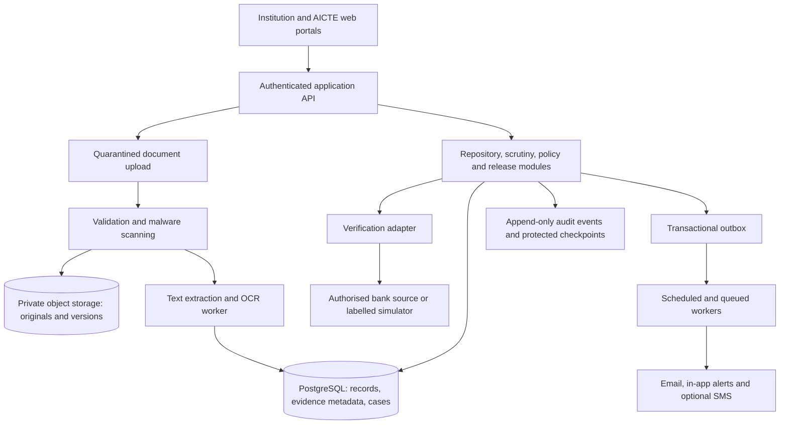

# SIH 2026 — Problem 26265: Security Deposit/FDR Portal

Research and solution brief • Prepared 20 October 2026 • Organisation: AICTE, Regulation Bureau • Category: Software • Theme: Smart Automation

## 1. Recommendation and evidence boundaries

Build **NidhiSetu — Security Deposit and FDR Lifecycle Management**: a central case-management platform that connects every institutional deposit obligation to its instruments, documents, independent verification evidence, deadlines and authorised decisions.

The key proposition is: **Every instrument has a traceable history, every verified field has evidence, and every pending action has an owner.**

This document is a proposed design, not an assertion that AICTE currently uses these exact processes, APIs or deadlines. The user-provided problem statement is the requirements baseline. Public sources support the contextual findings below. Prototype features, staffing, schedules and performance thresholds are proposals. There are no measured AICTE baseline statistics in this research.

Assumptions: a student team builds a web prototype using synthetic institutions and instruments; bank responses and AICTE identity integration are mocked unless formal access is obtained. The portal records and administers financial instruments; actual funds move only through separately authorised financial procedures.

## 2. Understand the problem in plain language

A security deposit is money or an accepted instrument maintained to meet a regulatory requirement. An FDR is the bank's receipt for a fixed deposit. AICTE needs to know whether the institution has provided the required security, whether the evidence is reliable, what administrative actions remain and whether a release has been authorised.

An uploaded PDF addresses only one part of that problem. The officer still needs to connect it to the correct institution, obligation, programme, bank reference, dates and previous instruments. They must reconcile discrepancies, obtain confirmations where possible, follow up before deadlines and preserve the reasons behind decisions.

Consider a hypothetical institution with three instruments: one awaiting bank confirmation, one approaching maturity and one being replaced. A single label such as “Active” cannot explain its position. AICTE needs separate views of the claimed deposit, confirmed evidence, upcoming actions and release eligibility.

The underlying problem has five parts:

1. **Record fragmentation:** a case may be spread across PDFs, registers, email and portal entries.
2. **Uncertain evidence:** institution-entered information may be mistaken for bank-confirmed information.
3. **Time-sensitive obligations:** maturity, validity, replacement and regulatory deadlines may differ.
4. **Administrative coordination:** scrutiny, bank responses, clearances and approvals need owners and histories.
5. **Accountability:** financial decisions must remain explainable after staff, documents or rules change.

The stakeholder mapping should be validated through interviews; the problem statement describes risks, not a completed audit of AICTE's current operating systems.

## 3. Research findings that affect the design

### 3.1 AICTE policy and existing digital workflows

AICTE's 2024–27 handbook spans academic years 2024–25 through 2026–27. Section 1.12 differentiates applicability and amounts by institutional/programme conditions, with exemptions and a qualified ten-year term. Section 6.46 requires release records and departmental clearances: FDR/RPGF cases use an NOC; RTGS cases use a sanction order. The handbook already directs release applications online. These are a baseline to reconcile with later amendments, not a complete rule configuration. [AICTE handbook, official indexed PDF](https://aicte.gov.in/sites/default/files/APH%20Final.pdf), [readable copy of the AICTE publication](https://thdcihet.ac.in/wp-content/uploads/2024/12/AICTE-approval-handbook.pdf).

An AICTE e-governance RFP describes JFDR applications, supporting records, scrutiny by multiple offices, return for corrections and progress tracking. It is historical evidence of an existing workflow, not proof of the present production implementation. [AICTE RFP, section 7.2.2](https://aicte.gov.in/sites/default/files/RFPeGov.pdf).

**Design implication:** position this solution as an improvement in evidence quality, lifecycle monitoring and administrative visibility. Avoid claiming to introduce AICTE's first online FDR process.

Older handbook editions contain different provisions. Do not transfer an old rule into the 2026 prototype merely because a search engine surfaces it. Maintain a policy register with the document version, effective period, clause, applicability and approving authority.

### 3.2 Bank integration is possible, but access is conditional

HDFC publishes an FD financial-information API description. Axis lists fixed-deposit API products. ICICI describes an API-enabled electronic FDR service specifically for stockbrokers and exchanges. These establish that bank-specific digital capabilities exist; they do not establish an open, universal FDR verification endpoint or access for AICTE. [HDFC API](https://developer.hdfc.bank.in/fd-fetchfinancialinfo-v1), [Axis API catalogue](https://apiportal.axis.bank.in/portal/product-details/70), [ICICI e-FDR service](https://www.icici.bank.in/business-banking/capital-market-and-securities-market-services/electronic-fixed-deposits-receipts).

**Design implication:** use a verification adapter with separate implementations for an approved bank API, a bank-issued digital verification service, and an evidence-backed manual confirmation route. Show the mock adapter visibly in the SIH demo.

The Department of Financial Services describes Account Aggregators as consent-based and defines an FIU as an entity registered with and regulated by a financial sector regulator. AICTE access cannot be assumed. Even accessible financial information would need to contain the specific evidence required for an institutional FDR, such as a relevant lien or beneficiary. [DFS Account Aggregator framework](https://www.financialservices.gov.in/account-aggregator-framework).

**Design implication:** Account Aggregator is a feasibility investigation for later, not an MVP dependency or promised integration.

### 3.3 Digital signatures support provenance, with limits

CCA's verification guidance requires the signer's certificate and issuer chain; it also discusses revocation information and long-term verification. Its eSign service is available through service-provider integration. [CCA signature verification](https://www.cca.gov.in/index.php/signature_verification.html), [CCA eSign](https://cca.gov.in/eSign.html).

**Design implication:** signature validation can support document integrity and signatory identity. It does not by itself establish the signer's bank authority or prove that a deposit remains live today. Keep document signature status separate from bank-confirmation status. A pasted signature image is not cryptographic signature verification.

### 3.4 Security, privacy and accessibility shape production readiness

OWASP recommends layered upload controls: allowed extensions, file-type validation, generated filenames, limits, restricted storage and malware checks. [OWASP File Upload guidance](https://cheatsheetseries.owasp.org/cheatsheets/File_Upload_Cheat_Sheet.html).

CERT-In's directions include specified incident reporting within six hours and secure retention of ICT logs for a rolling 180 days within India. Applicability and incident-handling procedures must be checked for deployment. Operational security logs and the business case record require distinct retention schedules. [CERT-In directions](https://cert-in.org.in/PDF/CERT-In_Directions_70B_28.04.2022.pdf), [CERT-In FAQs](https://www.cert-in.org.in/PDF/FAQs_on_CyberSecurityDirections_May2022.pdf).

The notified DPDP Rules 2025 have staggered commencement: some rules apply at publication, Rule 4 after one year, and the listed substantive rules after eighteen months. As of this brief's date, do not describe every provision as already operational. Design for applicable personal-data obligations and have the deployment owner establish the legal basis, commencement dates and retention requirements. [Official notified rules, Rule 1](https://www.meity.gov.in/static/uploads/2025/11/53450e6e5dc0bfa85ebd78686cadad39.pdf).

GIGW 3.0 aligns accessibility with WCAG 2.1 AA. Its conformity matrix also addresses a security audit before production hosting. [GIGW accessibility](https://guidelines.india.gov.in/new-features-of-gigw-3-0/), [GIGW conformity matrix](https://guidelines.india.gov.in/annexure-ii-matrix-to-check-conformity/).

**Design implication:** build institution-level isolation, private document access, accessible workflows, security monitoring and an audit-ready case history into the core architecture. A hackathon demonstration is not a government security certification.

## 4. Stakeholders and access model

| Role | Main work | Scope and restrictions |
|---|---|---|
| Institution submitter | Draft records, upload evidence, respond to queries, request renewal/release | Own institution only; cannot change independent confirmation |
| Institution authorised signatory | Attest and submit prescribed records | Authority and signing requirements must be validated |
| Scrutiny officer | Compare evidence, raise discrepancies, record observations | Assigned jurisdiction/cases; cannot silently rewrite submitted evidence |
| Supervising officer | Assign cases, resolve escalations, review workload | Designated organisational scope |
| Competent approving authority | Decide approved workflow transitions | Cannot self-approve a case prepared by the same actor where separation is required |
| Finance/clearance participants | Record relevant clearances and execution references | Task-specific information only |
| Bank verifier, if formally enabled | Confirm bank-owned instrument facts | Assigned bank/instruments; no broad institutional document access |
| Auditor | Inspect history, evidence and decisions | Read-only, authorised scope |
| System administrator | Manage accounts, roles and configuration | Infrastructure access does not confer financial approval authority |

Implement role plus institution/jurisdiction checks on the server for every API, export and document download. Frontend button hiding is only a convenience.

## 5. Full functional plan and requirements traceability

| Problem-statement capability | Proposed implementation | Evidence to show in demo |
|---|---|---|
| Central repository | Institution → regulatory obligation → instrument allocation | One institution with multiple instruments and obligations |
| Digital documents | Quarantine, validation, private storage, versions and retrieval | Upload a correction while retaining the original |
| Verification/discrepancies | Compare submitted, extracted and independently confirmed fields | Amount/date mismatch with source evidence |
| Validity/maturity | Separate date fields and scheduled evaluations | Simulated time crosses reminder thresholds |
| Renewal/replacement | Linked successor instruments and coverage assessment | Replacement submitted but not yet independently verified |
| Release/refund | Request, checklist, clearances, approval, execution reconciliation | Missing clearance blocks progression |
| Alerts/escalation | Configurable recipients, deadlines, delivery states and ownership | Overdue task escalates once; failed delivery is visible |
| Dashboard/reports | Counts, amounts, aging, deadlines and assigned actions | Filter a management total to underlying cases |
| Audit/access | Append-only events, separation of roles, controlled exports | Institution A fails to access institution B's file |
| Integration/security | Adapter contracts, authentication, encrypted storage and backups | Bank timeout stays unconfirmed; mock mode is labelled |

### 5.1 Repository and data capture

Capture institution ID and authoritative identity, trust/society/company where relevant, programme/approval linkage, obligation reference, instrument type, bank and branch, bank reference, principal, currency, issue and maturity dates, and lien/beneficiary details where required. Record physical custody or original-document references where an applicable procedure needs them.

Each submission has its own version and declaration. Every extracted value stores document ID, page, location and confidence. Every external confirmation stores its method, source, observed time, verified fields and supporting evidence.

Digitally born PDFs should use text extraction first. Use OCR for scans. Show the result beside the original; require review of financially important fields. An uncertain OCR result should prompt correction, not become an official discrepancy automatically.

### 5.2 Verification and discrepancy workbench

For each important field, show three columns: **Institution submitted | Document extracted | Bank confirmed**. Keep “not provided,” “not supported,” “pending,” “contradictory” and “confirmed” distinct.

Examples of explainable rules:

- Claimed principal differs from the bank's confirmed principal.
- The scan appears to have a different maturity date; extraction confidence is low, so an officer must inspect it.
- Mandatory evidence under the selected policy version is missing.
- A bank/reference combination resembles an existing instrument; request review before treating it as duplication.
- A beneficiary or lien requirement is unconfirmed by the available source.
- A proposed replacement creates an apparent coverage gap, subject to the applicable policy.

Do not label a case “fraudulent” from image editing traces, an OCR disagreement or a risk score. Use “requires scrutiny,” with the rule and evidence visible. An unavailable API means no current confirmation, not a failed authenticity check.

Manual verification should use independently obtained official bank contact channels and preserve the request, response, officer, date and verification basis. Do not trust contact details solely because they appear in the submitted document. Formal procedure and authority determine which channels are acceptable.

### 5.3 Date monitoring and alerts

Keep at least these dates distinct: bank maturity date, instrument-validity end where applicable, regulatory obligation end and next required administrative action. An instrument can mature while a regulatory obligation remains open; a new maturity date cannot itself extend or end the regulatory obligation.

Example configurable reminders: 90, 60, 30 and 7 days before a relevant action deadline. These are demonstration settings, not published AICTE mandates. Officers can configure reminders only within their authority.

Each reminder needs an event key, recipient, channel, delivery state, attempt count, acknowledgement where supported, next action owner and escalation rule. Use a digest for routine items and immediate notices for urgent cases. Re-evaluate reminders after changes, and suppress obsolete reminders for superseded instruments when policy permits.

### 5.4 Renewal and replacement continuity

Keep the original instrument and create a successor record. Link A → B → C and show the effective dates, evidence, principal changes and reasons. Submission of B is not equivalent to approval of B.

Measure coverage against the obligation using only eligible, approved allocations for the relevant period. Avoid counting old and replacement instruments twice in portfolio totals. If one instrument is formally allocated across multiple requirements, record the allocation amounts and enforce limits; otherwise flag reuse for scrutiny.

Assess three concerns separately: **amount sufficiency**, **continuity over required periods** and **freshness/completeness of evidence**. Where a rule or banking status is unknown, show an unresolved assessment instead of inventing compliance.

Renewal is available only for cases where the applicable rule and approved administrative procedure permit or require it. The problem statement's renewal feature is not a universal instruction to renew every matured deposit.

### 5.5 Release, discharge and refund

Proposed workflow:

Request → completeness review → applicable checks and clearances → competent-authority decision → authorised order/NOC → execution evidence → reconciliation → closure.

Make the required checklist and clearance participants policy-configurable. Run independent checks in parallel where approved routing permits. Store queries, holds, returns, rejections and reasons as first-class records. Any change to a material field after approval must invalidate or route the affected decision for review.

Keep **release approved**, **instruction issued** and **bank/finance execution confirmed** separate. The application must not say “refunded” simply because an officer approved the request. Capture the financial reference and reconcile execution through the authorised source before final closure. Do not implement actual money movement in the student prototype.

## 6. State model: avoid a single overloaded status

| Dimension | Example states |
|---|---|
| Submission | Draft, submitted, returned, resubmitted, accepted for review |
| Independent verification | Not requested, pending, partially confirmed, confirmed, conflicting, unavailable |
| Financial instrument | Recorded as live, maturity reached, replacement linked, discharged; supported by source/time |
| Administrative case | Under scrutiny, clarification pending, clearance pending, approved, rejected, on hold, closed |
| Obligation assessment | Sufficient, potential shortfall, potential gap, completed, unresolved |

Example case: “Maturity reached; bank evidence from 12 days ago; release clearance pending; obligation assessment unresolved.” This is much more actionable than a green “Verified” badge.

Every state transition has an actor, preconditions, required evidence and event record. Use server-side transactions and version checks to prevent concurrent approvals or edits from overwriting one another.

## 7. Architecture and technology choices

Evaluate three approaches:

| Approach | Strength | Weakness | Recommendation |
|---|---|---|---|
| Document repository plus reminders | Quick to build | Limited evidence reconciliation and approval controls | Useful only as an initial slice |
| Workflow application with OCR assistance | Covers the actual lifecycle and accountability requirements | Requires a careful data/state model | Recommended |
| Full banking integration platform | Potentially stronger source confirmation | Dependent on contracts, bank scope and production access | Future deployment phase |

Use a **modular monolith**: one backend with clear modules, one relational database and asynchronous workers. Separate services only when operational requirements justify them.

Suggested prototype stack:

- React and TypeScript for the user interface.
- Django with Django REST Framework for the backend, permission controls and administrative support.
- PostgreSQL for structured data, transactions and reporting.
- Private S3-compatible object storage; choose a local storage implementation for a fully offline demo if needed.
- Celery with Redis for OCR tasks, reminders and retries; persist business delivery records in PostgreSQL.
- Text extraction followed by PaddleOCR or Tesseract where needed; benchmark the chosen engine on the actual scan set.
- Containerised local environment and a repeatable synthetic-data seed.
- Standards-based identity integration in production; seeded role accounts only for the demo.

PostgreSQL row policies can supplement application-level institution isolation; its documentation notes exceptions for owners and privileged roles, so use a restricted runtime database identity. [PostgreSQL row security](https://www.postgresql.org/docs/current/ddl-rowsecurity.html).

Celery documents periodic scheduling and the risk of overlapping tasks. Use a single scheduling authority, locks where needed and idempotent processing. [Celery periodic tasks](https://docs.celeryq.dev/en/stable/userguide/periodic-tasks.html). [PaddleOCR documentation](https://www.paddleocr.ai/main/en/index.html) is a starting point for evaluating extraction, not a guarantee of FDR accuracy.

Write a transaction's state change, audit event and outbox notification together. Workers may retry delivery without repeating financial decisions. Validate webhook signatures, timestamps, request identifiers and instrument-version bindings; reject replayed or stale confirmations.

## 8. Core data model

| Entity | Important fields and purpose |
|---|---|
| Institution | Stable AICTE reference, legal identity, jurisdiction |
| RegulatoryObligation | Applicable programme/reference, required security, term and policy version |
| Instrument | Type, bank reference, principal in exact decimal/paise, issue/maturity dates |
| InstrumentAllocation | Obligation, instrument, allocated amount, effective period, approval/evidence |
| InstrumentRelation | Renewal/replacement/transfer predecessor and successor |
| SubmissionVersion | Immutable submitted values, author and declaration time |
| DocumentVersion | Private object key, hash, original filename, version, uploader, classification |
| FieldEvidence | Field, value, source, document/page, observed time, extraction/verification method |
| VerificationRequest/Result | Source, correlation ID, confirmed field scope, response and expiry/freshness |
| Discrepancy | Rule, severity, evidence, owner, response and resolution |
| Case/Task | Case type, assigned officer, deadline, current version and state |
| Clearance/Decision | Department, authority, decision, reasons, evidence snapshot and timestamp |
| ReleaseExecution | Order, authorised execution reference, reconciliation and completion evidence |
| Notification | Event key, recipient, channel, delivery attempts and state |
| PolicyVersion | Source, clause, effective dates, cohort, approved rules and publishing history |
| AuditEvent | Actor, action, case version, changed fields, reason, time and correlation ID |

Store references as strings to preserve leading zeros. Use exact arithmetic for money. Store timestamps consistently and render in the user's relevant timezone; treat contractual calendar dates separately. Do not impose global uniqueness on an FD number alone: use bank/reference context and a canonical instrument identifier.

Illustrative API groups: submissions and versions; document upload/download; scrutiny and discrepancies; verification requests/results; successor instruments; release requests/clearances/decisions; deadlines and alerts; dashboard/report exports; authorised audit retrieval. Every mutation validates the actor, case version and allowed state transition.

## 9. Security and operational design

Use MFA for officials and sensitive privileged accounts. Authorise every record and object download. Encrypt traffic, databases/backups and object storage; manage keys separately from application secrets. Use short-lived file access links and prevent account identifiers or sensitive attachments from entering routine alerts.

Quarantine uploads before preview or OCR. Enforce MIME/file signatures, size/page limits and safe preview generation. Retain the exact original bytes: sanitisation or reconstruction can invalidate digital signatures, so derivative previews must be stored separately. Isolate parsers and do not let extracted document instructions trigger application actions.

Record submissions, field changes, evidence updates, decisions, downloads, exports and privileged changes. Limit updates/deletions to audit records, then checkpoint event hashes into independently controlled storage. Hash chaining helps detect changes when protected checkpoints exist; a database administrator who controls both data and hashes can otherwise rewrite the chain. A document hash proves byte consistency, not authentic issuance by a bank.

Define access review, staff transfer/delegation, incident reporting, secrets rotation, backup/restore testing, retention, legal hold and export controls. Retention must cover applicable statutory/administrative needs and personal-data minimisation; do not delete case history automatically at instrument maturity.

Production should use an AICTE-approved deployment and security-review process. Government cloud/NIC integration, disaster recovery targets, SSO and bank contracts require stakeholder agreement. Do not claim certifications based on selecting an Indian cloud region.

## 10. Dashboard and screen design

**Institution dashboard:** submissions requiring action, documents requested, upcoming dates, release progress and successor-instrument history. Use draft saving, accessible labels, date validation and an upload checklist.

**Officer dashboard:** assigned workload; unconfirmed/partly confirmed records; discrepancies; approaching deadlines; pending clearances; aging buckets; and a “next action, owner, due date” queue.

**Verification workbench:** original document on the left; submitted/extracted/confirmed comparison on the right; source and evidence time beside each field; discrepancy creation below.

**Instrument timeline:** submission, queries, confirmations, maturity, replacement and release events with downloadable authorised evidence.

**Management reporting:** separate recorded principal, independently confirmed principal and principal awaiting confirmation. Include case aging and alert delivery failures. Treat expiring instruments, pending verifications and release cases as overlapping dimensions, not mutually exclusive slices of a single pie chart. Specify the aggregation grain and avoid replacement double counting.

## 11. Differentiation and appropriate AI

The standard repository, dashboard and reminders satisfy baseline requirements. Prioritise these stronger differentiators:

1. **Evidence provenance:** each field shows who asserted it, who independently confirmed it, how and when.
2. **Renewal continuity:** show coverage across the entire obligation, including replacements, potential gaps and pending evidence.
3. **Policy versioning:** replay a decision using the rule version and evidence that existed at decision time.
4. **Decision evidence package:** export an authorised case packet containing the material evidence, scrutiny responses, clearances and reasons.
5. **Explainable work prioritisation:** order queues by approaching deadline, monetary exposure, discrepancy severity and pending duration; show the reasons.

AI should assist extraction, document classification and draft summaries with references. Deterministic rules should evaluate dates, arithmetic, mandatory fields and authorised transitions. Humans decide disputed facts and regulatory outcomes. Avoid a generative model making release decisions, producing unsupported fraud allegations or inventing policy.

An optional policy assistant can answer only from approved, versioned publications and show clause links. It must respect case access restrictions and say when a rule is missing or ambiguous. Implement only after the core lifecycle works.

## 12. MVP scope, team ownership and delivery

### MVP: a complete narrow slice

Build institution submission; private document versions; extraction with review; a discrepancy workbench; a labelled bank simulator; date monitoring; a successor chain; a multi-role release flow; dashboard filters; and a traceable audit timeline.

Defer live banking, actual payments, national SSO, account aggregation, large legacy migration, predictive fraud models and multilingual policy chat. Keep extension points in the design without pretending these integrations exist.

Suggested ownership for six team members, adaptable to actual skills:

| Owner | Deliverable |
|---|---|
| 1 | Institution submission experience and accessibility |
| 2 | Officer dashboard, scrutiny and timelines |
| 3 | Backend data model, permissions and policy checks |
| 4 | Document pipeline, extraction and comparison |
| 5 | Alerts, bank simulator, integration contracts and audit events |
| 6 | Release workflow, test coordination, deployment and pitch evidence |

All owners share acceptance criteria, schemas and API contracts first. Responsibilities are a planning suggestion, not a reason to split tightly coupled state changes across incompatible implementations.

### Six-week preparation plan

| Week | Work | Exit criterion |
|---|---|---|
| 1 | Interviews, applicable-rule register, real-process mapping, synthetic sample formats, wireframes | Each requirement has an owner and acceptance scenario |
| 2 | Identity/roles, institution model, obligations, instruments, private upload | Complete submission persists and cannot leak across institutions |
| 3 | Extraction, provenance, comparison and simulated verification | Contradictory evidence is visible and resolvable |
| 4 | Scheduled alerts, retry handling, replacement chain and coverage checks | Time simulation and replacement cases behave correctly |
| 5 | Release checks, clearance routing, approvals, execution tracking and reports | A missing clearance blocks approval; completion needs execution proof |
| 6 | Security/access tests, extraction evaluation, performance measurement and presentation | Reproducible demo and measured result sheet |

### Illustrative 36-hour hackathon plan

- Hours 0–4: confirm scope, seed data, permissions and shared API/state contracts.
- Hours 4–12: finish submission, storage and the two main dashboards.
- Hours 12–20: complete evidence comparison, labelled bank responses and discrepancies.
- Hours 20–27: finish reminders, replacement linkage and release roles.
- Hours 27–32: run acceptance and access tests; fix failures.
- Hours 32–36: capture measured results, rehearse and prepare an offline fallback.

Assumes prior preparation and a small working foundation; building every proposed production feature during 36 hours is unrealistic.

## 13. Test scenarios and acceptance criteria

| Scenario | Expected result |
|---|---|
| New complete submission | Versioned record, protected evidence and assigned scrutiny task |
| Missing prescribed evidence | Clear checklist; submission handling follows configured policy |
| Blurred principal/date | Uncertain extraction highlighted for human review |
| Institution amount differs from bank confirmation | Field discrepancy; source records remain unchanged |
| Bank timeout | Pending/unavailable state with retry; never silently marked confirmed |
| Partial bank response | Only returned fields marked confirmed; unsupported lien stays unconfirmed |
| Replayed/stale callback | Rejected or recorded without overwriting newer evidence |
| Reminder threshold reached | One logical notification per configured event/recipient/channel |
| Worker restarts after downtime | Reconciles due/overdue work without duplicate case transitions |
| Reminder delivery fails | Retry and visible failed-delivery task; not falsely counted as received |
| Successor submitted | Earlier record preserved; successor verification still required |
| Overlap or gap in replacements | Explainable assessment; no double-counted security |
| Matured instrument | Routes to applicable next action, not automatic refund |
| Missing clearance | Approval transition blocked with a reason |
| Same actor prepares and approves | Blocked where separation of duties is configured |
| Two officers approve concurrently | One valid transition; stale attempt rejected |
| Approval recorded, execution absent | “Approved, awaiting execution,” not “Refunded” |
| Institution A requests B's API/file/export | Denied on the server |
| Malicious/oversized upload | Rejected or quarantined before parsing/preview |
| Policy changes | New version applies to selected cohort; old decisions retain old evidence/rules |
| Backup restore | Case, document and audit references remain consistent |

Use clean, blurred, rotated and digitally born documents from multiple fictional bank layouts. Include deliberate contradictions, missing fields, legacy-style records, replacements and release holds. Use conspicuous synthetic markings without copying real private banking documents.

## 14. Measurement plan: demonstrate improvement honestly

Create a labelled set of about 100 synthetic documents for extraction and 200 instrument/case records for lifecycle scenarios. These are suggested initial evaluation sizes, not national-scale evidence. Keep a held-out portion that was not used to tune extraction rules.

Compare the same tasks through a spreadsheet/manual prototype and the portal. Alternate task order, use multiple testers and record median and slower-case times. If real staff are unavailable, describe results as a student usability simulation. Separate officer handling time from bank waiting time and overall verification turnaround.

| Metric | Method | Proposed target, not achieved result |
|---|---|---|
| Critical-field accuracy after review | Correct required principal/reference/date fields ÷ labelled fields | At least 99% on the defined sample; report raw OCR accuracy separately |
| Officer handling time | Median active minutes per comparable case | At least 50% reduction against measured test baseline |
| Verification turnaround | Submission to sufficient independent confirmation | Report separately by source; no unsupported reduction promise |
| Reminder generation coverage | Due logical reminders generated ÷ expected reminders | 100% on the deterministic test set |
| Reminder delivery | Delivered/failed/pending by channel | Report actual provider/simulator outcome separately |
| Replacement gap detection | Expected gap/shortfall cases correctly flagged | 100% on designed cases, with false-positive count |
| Release-control correctness | Disallowed transitions blocked ÷ attempted disallowed transitions | 100% on defined tests |
| Access isolation | Forbidden API, download and export attempts denied | 100% on defined role/institution matrix |
| Audit completeness | Required material events found ÷ expected events | 100% on defined scenarios |
| Queue visibility | Cases with valid next action and owner ÷ actionable cases | 100% on test dataset |

Useful formulas:

- Time reduction = (baseline median − portal median) / baseline median × 100.
- Field error rate = incorrect required fields / required fields evaluated.
- On-time replacement rate = accepted qualifying replacements by deadline / replacements due; report sample and policy definition.
- Case age = current time − relevant stage-entry time; use both total age and time awaiting an external party.

Illustrative capacity calculation: if a measured test later shows handling time falling from 12 to 5 minutes for 1,000 comparable cases, the arithmetic is 7,000 minutes, or approximately 117 staff-hours. This is an example calculation, not a finding about AICTE or a measured prototype result.

## 15. Feasibility, costs and rollout

Avoid a national deployment price without expected volumes, hosting choices, bank contracts, audit requirements and support scope. Build a transparent cost worksheet instead:

Monthly total = application/worker compute + database + storage/backups + OCR processing + notification volume × channel price + monitoring/support + integration fees.

Annual total also includes security assessment, recovery exercises, maintenance, training and vendor management. Price free/open-source software separately from infrastructure, labour and compliance costs. A locally run prototype can avoid many usage fees but still consumes hardware and team effort.

Size a pilot with agreed institution and record counts; record average pages per instrument, peak uploads, reminder volume and concurrent reviewers. Validate storage projections and load-test the expected peak plus a documented margin before expanding.

Rollout stages:

1. Synthetic sandbox with the full lifecycle and failure scenarios.
2. Small authorised pilot using redacted or appropriately approved real cases and approved users.
3. One formally supported bank verification connection and AICTE identity mapping.
4. Reconciled legacy import, security review, staff training and recovery validation.
5. Wider rollout with agreed service objectives and case-quality monitoring.

For legacy imports: preserve source row/document IDs; map institutions; deduplicate for officer review; distinguish imported claims from confirmed evidence; reconcile counts and principal totals by batch; and require batch sign-off. Never convert “imported” into “bank verified.”

## 16. Research still required before production

| Question | Why it matters | Best validation route |
|---|---|---|
| Which APH amendments and case cohorts apply? | Prevents wrong amount/term/release rules | Regulation Bureau-approved policy register |
| Which instrument types and legacy holdings exist? | FDR, remittance and legacy funds need distinct treatment | Authorised sample and institution-wise inventory |
| What does the current portal already support? | Avoids duplicating JFDR/approval systems | Demonstration by authorised AICTE users |
| Which facts must banks confirm? | Establishes evidence schema and source scope | AICTE and issuing-bank operations staff |
| Are bank APIs/portals contractually available? | Determines realistic integration scope | Bank agreements and technical onboarding |
| Who may sign, clear, approve and execute? | Defines separation of duties and routing | Written delegation and financial procedure |
| How should auto-renewed/legacy instruments be handled? | Prevents unsafe blanket renewal assumptions | Case-specific policy and bank confirmation |
| What are actual handling times and backlogs? | Provides a valid improvement baseline | Consented process observation and anonymised task timings |
| What retention, residency and recovery requirements apply? | Determines production infrastructure and governance | AICTE IT, records, finance and legal owners |
| What is the official SIH 2026 submission template? | Determines final slide structure and file requirements | Current official SIH portal and college SPOC |

These are validation tasks, not reasons to stop a synthetic prototype. Keep unresolved points visible in the design and demo.

## 17. Demonstration story

Use one fictional institution and three cases. Label every page and mock external response as demo data.

1. Upload a new synthetic FDR, review extracted fields and submit it.
2. Compare a deliberately different bank-confirmed principal against the submitted amount. Raise and resolve a discrepancy without erasing the original.
3. Advance a controlled demo clock to show a reminder and an overdue task. Never change the production host clock.
4. Submit a replacement, show its pending evidence and demonstrate the coverage timeline.
5. Request release on a separate eligible demo case. Show a missing clearance blocking approval, then complete the authorised roles and record simulated execution evidence.
6. Open the audit timeline and management queue to show who acted, why and what remains.

Close with measured test results, explicitly separated from planned targets and future integrations.

## 18. Source limitations

The official national SIH 2026 template and a readable official listing for PS 26265 could not be confirmed during this research; the statement supplied by the user anchors the scope. No submission deadline or national slide-count mandate is inferred from college-specific pages. The separate storyboard is a suggested six-slide structure.

The official AICTE handbook URL was search-indexed but its full direct fetch failed; the same AICTE publication was read through an institutional PDF mirror. Later AICTE amendments were not comprehensively verified. CERT-In directions were available through official indexed extracts, while full PDF fetches failed. These limitations matter for production policy, so the report does not claim a complete legal or integration audit.

No real AICTE/bank system was accessed, no confidential records were used, no prototype was built and no performance benchmark was run as part of this research brief.
