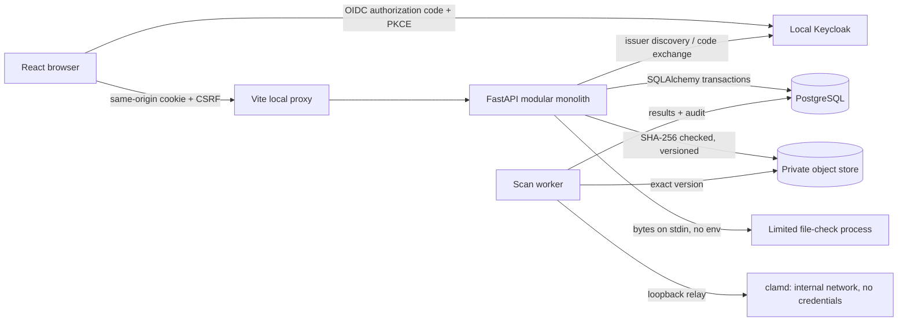
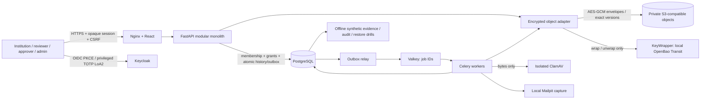

# Architecture and decisions

`auth` owns identity/session integration; `security` owns server-side grants, expiry and CSRF; `schemas` validates commands; `instruments` owns lifecycle and scoped queries; `models` owns persistence; migrations own schema history. API and UI communicate through JSON. The UI is not an authorization boundary. No bank/AI/provider tokens go to frontend localStorage.

## ADR-001: modular monolith

One API/process and relational transaction boundary keep instrument, snapshot and audit consistent. Microservices and a queue are not justified for M1. Future reminders and document processing can use workers with explicit idempotency/outbox once introduced.

## ADR-002: OIDC and local authorization

Authlib validates OIDC; Keycloak is the local provider. A token subject maps to a provisioned local user and institution. Token role claims do not confer portal privileges. Opaque app session tokens are hashed in PostgreSQL. Trade-off: requests depend on database availability; no independent token revocation window.

## ADR-003: concurrency and evidence

Row locks serialize mutations, If-Match protects stale clients, and one immutable snapshot exists per instrument. Same actor/idempotency key replays its result. Institution-submitted values always remain unverified. Bank evidence must be a separate later model, never inferred from OCR.

## ADR-004: small frontend

React + strict TypeScript + fetch and local state serve one register/details flow. Router/query cache packages are deferred until multiple independent routes justify them. Types mirror published API fields; they are currently maintained manually, not generated. A generated client is appropriate as the contract expands.

## ADR-005: deliberate demo boundary

Only local configuration is accepted. HTTP cookies lack Secure solely for loopback demonstration. Production rollout requires a separate approved configuration, TLS and the security gates in SECURITY.md. No uploads or financial release are partially simulated as complete features.

## ADR-006: document intake (SAF-008)

Uploads go to a private versioned S3-compatible bucket; SeaweedFS 4.48 runs locally because MinIO stopped publishing community images. Any S3 service with versioning and SHA-256 checksums can replace it. The API keeps credentials; the browser never receives object URLs. Format checks (pypdf, Pillow) run in a separate, isolated Python process with an empty environment, CPU limit and timeout, reducing accidental credential propagation. The child still shares the application UID/filesystem: this is not a filesystem or credential-isolation sandbox. This process is not yet network-isolated or a malware scanner: SAF-009 moves scanning into a sandbox without database credentials or general network access. Files stay quarantined until then.

## ADR-007: isolated malware scanning (SAF-009)

The worker is the trusted orchestrator; clamd is the untrusted-content processor. The worker holds credentials and writes results; clamd holds none and sits on an internal network without egress. Docker cannot publish ports from internal networks, so a socat relay bridges loopback to clamd; the relay copies bytes only. Signature updates use a separate freshclam container sharing the signature volume (read-write, because the image's init changes ownership). The worker uses clamd's INSTREAM protocol directly, so no client library is added. Rows stay locked while a document is fetched and scanned: correct for one or several workers via SKIP LOCKED, but a lease/outbox (SAF-013) should replace it at scale.

## ADR-008: outbox jobs with Celery delivery (SAF-013)

PostgreSQL is the job ledger; Celery over Valkey only transports job ids. This keeps the outbox transactional and makes broker loss harmless: the relay republishes anything not claimed within a minute. Valkey (BSD licence) is used as the Redis-compatible broker and listens on 127.0.0.1:56379 to avoid clashing with a developer's own Redis on 6379. The worker uses Celery's thread pool. The relay is a 2-second loop rather than Celery beat, so scheduling stays in the database.

## ADR-008: bounded discrepancy explanations (SAF-024)

Use the existing comparison rules as the sole status authority. A read-only builder renders fixed advisory templates and structured source citations, reusing the authorized review case's data. It accepts only clean documents frozen into the submission, never an unsubmitted replacement or document from another case. It recomputes a basis digest on reads rather than persisting generated text. No migration, model SDK or external transfer is needed. Trade-off: deterministic phrasing is less flexible than an LLM, but testable and usable before provider/privacy/evaluation decisions. A model-backed explanation implementation remains deferred; this is explicitly a fallback, not an AI capability claim.

ADR-008 acceptance (24 October 2026): the user chose the local deterministic fallback for SAF-024. This is the selected implementation, not a temporary provider-selection block. Model integration requires a separate future decision.

## ADR-009: stateless local case summaries (SAF-025)

Use versioned deterministic templates over the existing authorized case view. An explicit material-source allowlist and canonical JSON SHA-256 digest identify the source basis; access-audit events and explanation presentation are excluded. Generation and revalidation share the reviewer authorization path. Citation anchors resolve in the same case view; document citations preserve submission hashes and storage versions. The summary is never consulted by release decision logic.

Browser snapshots remain in component memory only. A loaded source mismatch or server mismatch hides facts; regeneration reloads the source panels. Current summaries revalidate every 15 seconds and on focus, and errors hide their facts. Independent config flags allow either explanations or summaries to be disabled. No database/cache/model dependency or migration is required. Trade-off: no persisted summary history, no free-form model prose, and detection is bounded by polling/browser scheduling rather than real-time push. Large histories increase case-view query and digest cost; evaluate that under SAF-026/pilot workload before optimizing.

Summary revalidation has a 10-second timeout; expired validation hides facts and permits regeneration. After disabling and re-enabling summaries, reload the browser page to clear the disabled snapshot.

## ADR-010: portable local foundation, provider-neutral pilot gates

Retain the modular monolith and shared transactional PostgreSQL model. Package the
same API/worker source and React build in portable Docker images; an additive Compose
profile supplies a separate synthetic DB/bucket/queue and HTTPS front door. No
microservices/Kubernetes dependency is justified by the measured workload. The public
OIDC issuer remains loopback Keycloak; a fixed private backchannel handles containers
without weakening signed issuer validation. Production mode stays rejected. Trade-off:
local internal links/volumes and shared service identities do not meet pilot controls;
they are visible gates until a platform is selected.

## ADR-011: envelope encryption behind a small key interface

`KeyWrapper.wrap/unwrap` decouples storage encryption from provider credentials. Local
`TransitKeys` uses OpenBao with a short-lived token file and encrypt/decrypt-only policy;
a future approved KMS/HSM adapter can replace it. Established `cryptography` AES-GCM
provides per-payload random DEK/nonce and authenticated institution/object/purpose
context. S3 versions contain envelopes; DB SHA-256 still describes plaintext. The
adapter rejects old plaintext versions instead of migrating silently. Trade-offs:
key-service availability is necessary for protected reads, payloads are bounded/in-memory,
and lost wrapping keys mean lost ciphertext access. Key custody/recovery must be
designed with independent administrators before real data; no keys enter `.env`/repo.

## ADR-012: MFA assurance and migration 018

Require Keycloak TOTP/LoA2 for privileged roles and store only verified signed assurance
on the opaque server session. Each request checks current role and assurance so role
promotion cannot inherit a password-only session. Migration defaults false; old
privileged sessions reauthenticate. Keycloak federation is disabled configuration,
not a new authorization path. Trade-off: operators must provision the MFA-required
Keycloak role and test upstream assurance/recovery before federation is enabled.

## ADR-013: measured synthetic evidence cannot approve a pilot

Offline evaluation calls real parsers/builders with separately labelled synthetic
expectations; source/corpus/library hashes bind results. Required security tests are
collected independently with selection environment disabled and checked against exact
executed JUnit identities. The citation oracle checks exact section/source/version
associations. Local drills report component scope and incomplete whole-system gates.
`readiness.assess` records caller-provided evidence and unresolved assumptions; it
cannot grant production activation or independently attest approval. Trade-off:
representative accuracy, human utility, deployment load, external security assessment
and sponsor acceptance remain evidence the team must obtain, not generate.

## ADR-011: bounded optional LLM wording

Reviewer-triggered generation reuses existing source builders, adds a fixed Gemini REST adapter, and retains deterministic status authority. A PostgreSQL lock and durable reservations enforce cross-process limits. Exact source-digest allowlisting, explicit synthetic egress consent and private credentials gate calls. Revalidate permissions and sources after inference; display model prose separately from facts. No new infrastructure or agent tools. See [design and trade-offs](design/LLM-INTEGRATION.md).
