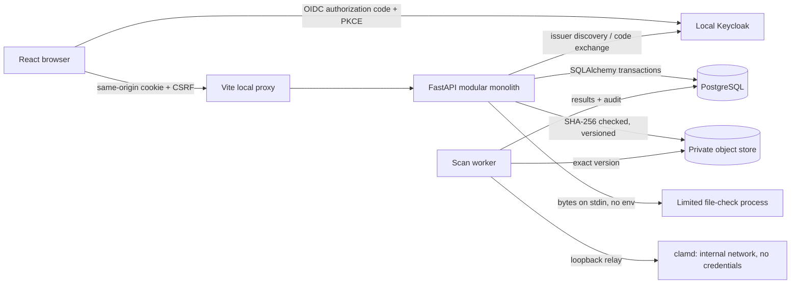

# Architecture and decisions

`auth` owns identity/session integration; `security` owns server-side grants, expiry and CSRF; `schemas` validates commands; `instruments` owns lifecycle and scoped queries; `models` owns persistence; migrations own schema history. API and UI communicate through JSON. The UI is not an authorization boundary. No bank/AI/provider tokens go to frontend localStorage.

## ADR-001: modular monolith

One API/process and relational transaction boundary keep instrument, snapshot and audit consistent. Microservices and a queue are not justified for M1. Future reminders and document processing can use workers with explicit idempotency/outbox once introduced.

## ADR-002: OIDC and local authorization

Authlib validates OIDC; Keycloak is the local provider. A token subject maps to a provisioned local user and institution. Token role claims do not confer portal privileges. Opaque app session tokens are hashed in PostgreSQL. Trade-off: requests depend on database availability; no independent token revocation window.

## ADR-003: concurrency and evidence

Row locks serialize mutations, If-Match protects stale clients, and one immutable snapshot exists per instrument. Same actor/idempotency key replays its result. Institution-submitted values always remain unverified. Bank evidence must be a separate later model, never inferred from OCR.

## ADR-004: small frontend

React + strict TypeScript + fetch and local state serve one register/details flow. Router/query cache packages are deferred until multiple independent routes justify them. Types mirror published API fields; they are currently maintained manually, not generated. A generated client is appropriate as the contract expands.

## ADR-005: deliberate demo boundary

Only local configuration is accepted. HTTP cookies lack Secure solely for loopback demonstration. Production rollout requires a separate approved configuration, TLS and the security gates in SECURITY.md. No uploads or financial release are partially simulated as complete features.

## ADR-006: document intake (SAF-008)

Uploads go to a private versioned S3-compatible bucket; SeaweedFS 4.48 runs locally because MinIO stopped publishing community images. Any S3 service with versioning and SHA-256 checksums can replace it. The API keeps credentials; the browser never receives object URLs. Format checks (pypdf, Pillow) run in a separate, isolated Python process with an empty environment, CPU limit and timeout, so parser failures cannot read API secrets. This process is not yet network-isolated or a malware scanner: SAF-009 moves scanning into a sandbox without database credentials or general network access. Files stay quarantined until then.

## ADR-007: isolated malware scanning (SAF-009)

The worker is the trusted orchestrator; clamd is the untrusted-content processor. The worker holds credentials and writes results; clamd holds none and sits on an internal network without egress. Docker cannot publish ports from internal networks, so a socat relay bridges loopback to clamd; the relay copies bytes only. Signature updates use a separate freshclam container sharing the signature volume (read-write, because the image's init changes ownership). The worker uses clamd's INSTREAM protocol directly, so no client library is added. Rows stay locked while a document is fetched and scanned: correct for one or several workers via SKIP LOCKED, but a lease/outbox (SAF-013) should replace it at scale.

## ADR-008: outbox jobs with Celery delivery (SAF-013)

PostgreSQL is the job ledger; Celery over Valkey only transports job ids. This keeps the outbox transactional and makes broker loss harmless: the relay republishes anything not claimed within a minute. Valkey (BSD licence) is used as the Redis-compatible broker and listens on 127.0.0.1:56379 to avoid clashing with a developer's own Redis on 6379. The worker uses Celery's thread pool. The relay is a 2-second loop rather than Celery beat, so scheduling stays in the database.
