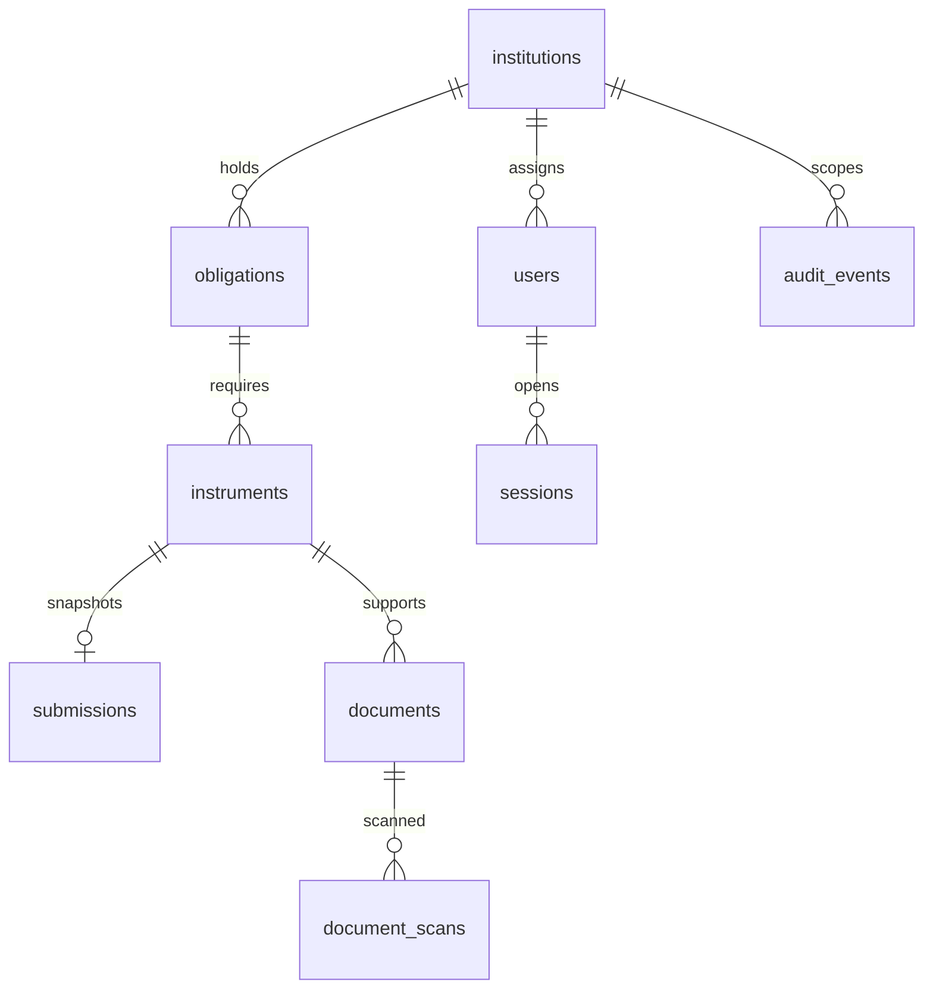

# Database

PostgreSQL 16 with Alembic versioned schema. Tables: institutions, users, sessions, obligations, instruments, submissions, documents, audit_events (see frozen migration for exact columns/constraints).

UUID primary keys; exact NUMERIC(18,2) principal; DATE issue/maturity; timezone-aware timestamps. Composite obligation/institution foreign key prevents mismatched associations. Positive amounts and ordered dates constrained at API and database. Indexes support institution/date listing and lookup; inspect migration for exact index coverage.

A mutation locks its instrument, validates actor/scope/version/state, and commits record + history together. PostgreSQL default READ COMMITTED plus explicit row locking is sufficient for current commands. No external request occurs inside a business mutation. Failure rolls back all business writes. Auth session last-seen is committed separately before command processing.

Submission unique instrument constraint enforces one snapshot. Database triggers reject UPDATE/DELETE of submissions and audit events. This is not DBA-proof: the local owner can disable triggers or truncate. Production separate app/migration roles and externally retained audit exports remain gates.

Migrations: `uv run alembic upgrade head`; test only: `uv run alembic -x test=true upgrade head`. Tests enforce database name safer_test before truncation. Never point TEST_DATABASE_URL at real data. No destructive downgrade is used as an operational rollback.

Documents (migration 003): composite instrument/institution foreign key; status pending → quarantined | failed only. A trigger rejects DELETE and any change to identity, hash, size, type, key, uploader or time, and forbids changing a row once it leaves pending, so a binding to an object version cannot be swapped. Bytes are never stored in PostgreSQL. Because storage and the database cannot commit atomically, pending metadata commits first, then the object, then the binding + audit; reconciliation closes the gaps.

Document scans (migration 004): append-only (same history trigger as audit), one row per attempt with object version, hash of the bytes actually scanned (null if fetch failed), outcome clean/infected/mismatch/error, engine version and signature. Clean requires a hash. Scan state is derived, never stored on the document. audit_events.actor_id is now nullable for the system scanner; the downgrade keeps it nullable rather than deleting history.

Migration 005: `obligations.required_documents` (varchar array, default `{fdr_certificate}`, constrained to known kinds) and `documents.kind` (constrained; earlier uploads backfilled as `other`, so they satisfy nothing). The document guard now also freezes `kind`. "Current" is derived (latest non-failed upload per kind), never stored.

Migration 006: role `reviewer`; `review_assignments` (reviewer, institution); append-only `evidence_records`, `discrepancies`, `discrepancy_replies` (history trigger), composite case/institution foreign keys, and a partial unique index allowing one resolution per discrepancy. Audit rows written by reviewers carry the reviewed institution's id so they appear in that case history.
Downgrading 006 deliberately fails while any user holds the reviewer role (the restored role constraint rejects them); remove or reassign those users first rather than deleting history.

Migration 007: `bank_requests` (case, submission, row version, provider, requester) and `bank_responses` (one per request, outcome, detail, raw answer), both append-only; evidence method `bank_simulator`. Locked re-reads now use `populate_existing` because sessions keep objects across commits; without it a locked row could be read from the session cache. Downgrade fails while simulator evidence exists, by design.

Migration 008: `jobs` (mutable job state; unique dedup key; partial index on due jobs) and append-only `job_attempts`; backfills scan jobs for quarantined documents without a final scan result.

Migration 009: `obligations.required_until`; append-only `reminder_schedules` (version 1 seeded) and `reminders` (unique per instrument and step, schedule version, due/generated times, late flag, message); index on `instruments.maturity_date`.

Migration 010: `users.email`; `notifications` (one row per reminder, recipient and channel, unique), content frozen by trigger while read and delivery state may change.

Migration 011: unique (id, institution_id, obligation_id) on instruments, and `replacement_links` with two composite foreign keys on that triple, a self-link check, partial unique indexes for one live link per side, and a guard trigger allowing only the single decision transition.

Migration 012: role `admin`; `grants` with checks for no self-grant/self-approval and dual control on release_approve, a partial unique index for one live grant per (user, authority, institution), and a guard trigger for allowed transitions; `review_assignments` migrated into active review grants and dropped.

Migration 013: `obligations.kind` (applicability key) and `policies` (unique code+version, publisher ≠ drafter check, end after start), with a trigger that permits only the draft → published transition and freezes all content.

Migration 014: `release_requests` (policy snapshot, status with allowed transitions enforced by trigger, decision recorded check, one live request per FDR), append-only `release_clearances` (one per clearance) and `release_events`.
