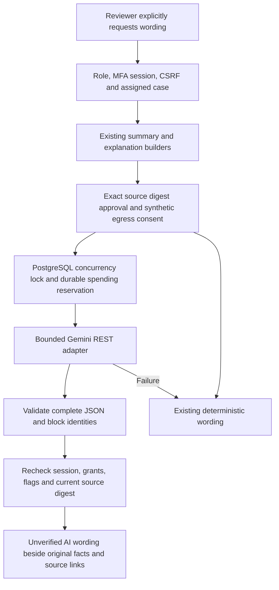

# Optional LLM assistance — 25 October 2026

Implementation scope: synthetic local integration of Gemini-generated wording for existing case summaries and discrepancy explanations. Default mode is off. No live model quality, latency, quota or India-residency acceptance is claimed.

## Architecture and boundaries

Provider module `llm.py` owns fixed HTTPS transport and strict response parsing. `ai.py` owns case authorization, source packaging and limits. Current comparison/release modules remain the only business-status authorities. There is no model tool access, arbitrary endpoint, database query generation, web search, document upload or conversation history. Existing GET explanations/summaries never invoke a model.

The source package reuses the full case summary digest, so source or evidence changes invalidate generated text. Per-block source links are attached by the server, never accepted from the model. Provider input excludes citation UUIDs/URLs, institution names, FDR references, request IDs, bank-name facts and free-text observations/evidence notes. Selected structured fields and code-authored guidance remain. This is minimization, not a privacy guarantee.

Model-generated wording is not factual evidence. Schema and source-id validation cannot prove prose truth. The UI displays original facts and deterministic guidance separately and marks generated prose as requiring human review. Model-authored statements must never feed status, release, authorization or deadline calculations. Live adversarial/factuality evaluation is mandatory before a controlled AI demo.

## API

- `GET /api/v1/reviews/{id}/ai?purpose=summary|explanations`: current authorized source blocks, full-case and AI basis digests, feature gate reason; no inference or reservation. Default purpose is summary.
- `POST /api/v1/reviews/{id}/ai`: `{ "purpose": "summary", "basis_sha256": "<64 hex characters from GET>" }`. Reviewer session, current institution assignment and CSRF required. Stale basis returns 409. Current fallback returns 200 with `mode=deterministic_fallback` and a safe reason. Successful wording returns `mode=llm`, model identity and `ai_text` beside each original block.
- Both return blocks with server-controlled `id`, `title`, `facts`, deterministic `text` and `citations`. No provider error body, key, hidden thinking or raw prompt is exposed.
- Mid-generation session/role/grant revocation returns 401/403/404, and changed facts return 409; no generated text is returned. The browser hides drafts during revalidation, on errors, on loaded source changes and while regenerating. Rechecks occur every 15 seconds and on focus; this is bounded polling, not instant revocation push.

## Configuration and enablement gates

All defaults keep outbound inference disabled:

| Setting | Default | Meaning |
|---|---|---|
| `LLM_MODE` | `off` | `gemini` selects the sole implemented adapter |
| `LLM_SYNTHETIC_EGRESS_APPROVED` | `false` | Explicit operator assertion of approved external processing of synthetic content |
| `LLM_API_KEY_FILE` | unset | Absolute path to owner-only regular file outside checkout |
| `LLM_APPROVED_SOURCES_FILE` | unset | Owner-only file outside checkout containing one reviewed AI basis SHA-256 per line |
| `LLM_MONTHLY_BUDGET_MICROUSD` | `2000000` | USD micro-units; default 2 USD reservation allowance per UTC month, zero disables paid admission |

Never place the key in `.env`, repository, browser, tickets or logs. Use a dedicated restricted provider key. Paths and nonsecret flags may be configured through the normal settings mechanism. The app rejects a Gemini startup without consent and both file paths. Private files must belong to the process user, prohibit group/other permissions, and be regular nonsymlink files. Missing/invalid files fall back without a provider call.

Before enabling: obtain explicit permission for a synthetic-only exception to the earlier India-only processing constraint. A generic Gemini Developer API account is not evidence of India-only processing. Obtain written AICTE data-owner approval and suitable contractual/residency controls before any real or anonymized FDR processing; this implementation does not authorize it.

For each synthetic case and purpose, GET the source package while mode is off; review the actual synthetic source records and the returned blocks, then place exactly its `basis_sha256` in the private approval file. Approval is operator-controlled and is never auto-added by the UI or API. A changed source needs fresh review. The allowlist binds source/purpose/model/prompt version; it cannot technically establish that a human has correctly classified the underlying data as synthetic.

No key or approval file is created by this task. No global local-mode restrictions are removed. Provider model is pinned to the stable identifier `gemini-3.5-flash-lite`; the provider may update that alias, so rerun live evaluation after provider/model behavior changes.

## Cost, concurrency and failure policy

- A PostgreSQL session advisory lock admits only one inference across application processes. The source-read transaction ends before admission; all inference bookkeeping and rechecks use a session bound to the same lock connection, avoiding nested pool checkouts. Competing requests immediately use local fallback. The lock is released explicitly and on database disconnect/crash.
- Each dispatched attempt permanently reserves **0.03 USD**, before the network call. The serialized check applies the configured UTC monthly allowance, 100 attempts per rolling 24 hours and 3 attempts per user per rolling minute. Failure and crash reservations remain charged against the allowance because actual provider processing can be uncertain.
- This deliberately conservative reservation is not a provider billing reconciliation. Actual token count is recorded when available; no refunds are issued. It assumes reviewed standard Gemini 3.5 Flash-Lite pricing. Recheck price/billing configuration before enabling, and use provider-side spending restrictions too. A key used by another application can incur costs outside this ledger.
- Entire serialized request capped at 20,000 bytes, at most 12 blocks; output cap 2,048 tokens; response body capped at 65,536 bytes. HTTP operations time out after 10 seconds of inactivity; the chunk loop checks a 20-second elapsed deadline. A blocked read can take up to another inactivity interval, so this is not a strict 20-second wall-clock deadline. Browser timeout is 35 seconds.
- No automatic retries, paid-provider switch, persistent response cache or growing chat history. Provider unavailable, refused, malformed, truncated, foreign/duplicate block or oversized output returns the existing deterministic text. All model output is rendered as React text, never HTML/Markdown.
- Fixed endpoint, TLS verification enabled, environment proxies disabled, redirects disabled, API key in header rather than URL. No SDK dependency was added; existing httpx/Pydantic are used.

## Database and operations

Migration 019 adds `llm_attempts` with actor/case identifiers, purpose, model, source digest, status, safe reason, duration, token count and reserved micro-USD. It stores no prompt, document, generated text or credential. Include the table in database backup/restore and keep the latest ledger when recovering service; restoring an older ledger can erase spend reservations. A separate provider cap is still necessary. Do not truncate this table in an active paid environment.

Apply normal additive migration before enabling: `PYTHONPATH=apps/api .venv/bin/alembic upgrade head`. Keep `LLM_MODE=off` for rollback/kill switch and restart services; data and deterministic review remain available. Schema downgrade drops the usage ledger, so do not downgrade while inference is enabled. Runtime database roles need access to the new table under the existing deployment grant procedure.

## Verification and remaining rollout

Automated tests use real local PostgreSQL for access/quotas and simulated HTTP at the provider boundary. Browser component tests use the real React component and controlled API responses. These establish application contracts, not provider quality.

Before live demo, evaluate a held-out synthetic set with multiple layouts, deliberate mismatches, absent evidence, simulator results and adversarial source text. Record exact model/prompt version, factual support, simulation labels, latency, fallback rates and actual billable tokens. Review every unsupported financial claim as a blocker. Assert zero cross-institution disclosure and zero authoritative writes. Do not relabel the earlier deterministic SAF-026 evaluation as LLM evaluation.

First release excludes unrestricted case chat, clarification sending and a regulatory knowledge base. Those require separate source/authorization designs. Oracle deployment and public hosting remain governed by the existing OCI plan and its unresolved gates.

## Official references (checked 25 October 2026)

- [Model capabilities](https://ai.google.dev/gemini-api/docs/models/gemini-3.5-flash-lite)
- [REST request/response](https://ai.google.dev/api/generate-content)
- [Structured outputs](https://ai.google.dev/gemini-api/docs/structured-output)
- [Pricing](https://ai.google.dev/gemini-api/docs/pricing): standard input 0.30 USD/million tokens, output including thinking 2.50 USD/million at review time.
- [Data terms](https://ai.google.dev/gemini-api/terms): free-tier product-improvement use and paid-tier handling differ; a paid account alone does not establish India residency.
