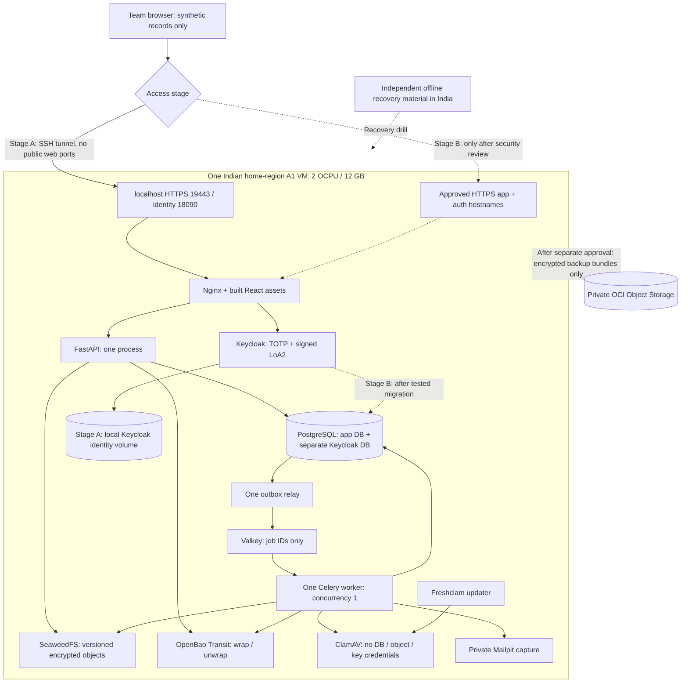

# SAFER — Oracle Always Free scaling proposal

**Draft v1 · 25 October 2026 · planning only; no resources provisioned or application configuration changed.**

The user has an Oracle free account and requested a plan within **2 OCPUs and 12 GB RAM**. This proposal keeps SAFER's modular monolith, PostgreSQL, Keycloak/TOTP, OpenBao Transit and synthetic-only data boundary. The recommended topology is one ARM VM. A public synthetic demo is a later, separately reviewed deployment step; a regulatory production pilot remains blocked.

## 1. Verified constraints and assumptions

Oracle currently documents A1 allowances of 1,500 OCPU-hours/9,000 GB-hours monthly, equivalent to 2 OCPUs/12 GB for an Always Free tenancy; 200 GB combined boot/block storage, five volume backups, and 20 GB combined object/archive storage with 50,000 requests/month for an Always-Free-only account after trial. Free compute belongs in the home region; capacity can be unavailable and idle compute can be reclaimed. A free flexible load balancer is capped at 10 Mbps. These are tenancy totals, shared with existing resources. Verify the actual Console before provisioning. [Oracle resource limits](https://docs.oracle.com/en-us/iaas/Content/FreeTier/freetier_topic-Always_Free_Resources.htm).

For **Ampere A1**, one OCPU is one core/one vCPU. Two OCPUs do not mean two eight-core processors. [Oracle compute shapes](https://docs.oracle.com/en-us/iaas/Content/Compute/References/computeshapes.htm).

The home region is not changeable. Mumbai and Hyderabad are listed Indian regions, but the account's home region/capacity is not yet confirmed. If it is outside India, this India-resident design is blocked until an approved tenancy/billing solution is selected; do not silently move to another country or create duplicate free accounts. Oracle-region location alone does not establish AICTE procurement or residency approval. [Region rules](https://docs.oracle.com/en-us/iaas/Content/Identity/Tasks/managingregions.htm), [region locations](https://www.oracle.com/cloud/public-cloud-regions/).

Always Free does not include an SLA or Oracle Support entitlement. This is a suitable prototype target, not a basis for promising regulatory uptime. [Oracle Free Tier FAQ](https://www.oracle.com/cloud/free/faq/).

Author proposals, not measured cloud results: one VM, storage layout, RAM caps, workload targets, backup retention and upgrade triggers below. No OCI account was accessed, no Oracle API was called and no Oracle load test was run. Prior laptop/ASGI measurements are not transferred into A1 capacity claims. Existing `APP_MODE`/loopback restrictions stay unchanged by this document.

## 2. Approaches and recommendation

| Approach | Benefit | Cost or limitation | Decision proposed |
|---|---|---|---|
| One A1 VM, 2 OCPU/12 GB, Docker Compose | Most usable CPU/RAM; reuse application and container work | One host failure affects every service; no HA | **Recommended starting point** |
| Two A1 VMs, 1 OCPU/6 GB each | Some separation of app and state | Same total resources, more OS/boot-volume overhead, network/TLS administration; one primary DB still fails alone | Defer until isolation justifies it |
| Rewrite around a free Oracle database/serverless components | Potentially offload some operations | Existing PostgreSQL JSONB, arrays, indexes, migrations, locking and triggers are not a drop-in fit; provider coupling | Reject for this budget |

Keep React/TypeScript/Vite, Nginx, FastAPI/Python, PostgreSQL 16, Celery/Valkey, SeaweedFS, Keycloak, OpenBao and ClamAV. Retain one transactional primary and existing job outbox. No Kubernetes, Kafka, new microservice decomposition, GPU inference or local LLM is justified on two cores. A managed PostgreSQL service is not budgeted as free in this plan.

## 3. Topology and access stages

Edges represent functional flow, not permission to share every Docker network. Separate public-edge, app/data and scan networks; restrict each service to necessary peers. ClamAV receives bytes only and has no storage/database/key credentials. The diagram does not represent a multi-node deployment or an HA cluster.

### Stage A: private cloud demo, minimum application change

- One `VM.Standard.A1.Flex`, ARM64 Ubuntu 24.04 LTS or another explicitly free-eligible supported image, subject to account inventory and capacity.
- Only SSH from the operator's approved IP or a reviewed bastion route. No public 9443/8090/5432/8333/6379/8200/3310/8025.
- Forward remote web port 9443 and identity port 8090 to unused operator loopback ports, proposed **19443** and **18090**, respectively. Configure the cloud instance's exact app origin, Keycloak public hostname/issuer and redirect URI to match those browser-visible ports. The current local-only validators permit these loopback ports. Bind tunnel listeners to loopback; use a separate browser profile because localhost cookies are not isolated by port. Do not disturb the existing local 9443/8090 demo. This works for a small trusted team, not general institution onboarding.
- Existing HTTPS/loopback checks and synthetic-only mode remain active; there is no reason to weaken validators merely to place the containers on a VM. Verify the exact local certificate trust anchor.
- Persist all necessary volumes explicitly on the attached data volume. Stage A retains the existing private-only Keycloak `start-dev`/local identity database; its identity volume is therefore a separate backup source. PostgreSQL identity storage is a Stage B migration, not an existing capability.
- Run OpenBao bootstrap/unseal/token issuance from the operator workstation over an approved SSH tunnel. Keep root/unseal/recovery material there, in a **new environment-specific private state directory**, never on the cloud VM or in application mounts. Deliver only runtime tokens to the VM's owner-only runtime files. Add a reviewed endpoint/state-path option to operator tooling rather than running the current hardcoded local bootstrap unchanged on the VM or reusing local-demo recovery files. One-hour token refresh stays manual initially; do not create a root-token cron job. The application/key interface is unchanged.

### Stage B: optional public synthetic demonstration

This needs code/configuration work and approval; the current app will reject a public hostname. Add a deliberate `synthetic_cloud` profile, rather than removing production/loopback validation globally. Permit only configured HTTPS origins and issuer, preserve signature/state/nonce/PKCE, exact redirects, CSRF and Secure cookies, and keep real-data activation blocked. A mode label cannot automatically detect an unauthorized real receipt; admission remains curated and restricted to synthetic fixtures.

Serve app and authentication hostnames through Nginx on 443, with an approved domain/certificate and tested renewal. Use Keycloak production mode with its own PostgreSQL DB/role, correct proxy/hostname settings, brute-force protection and privileged TOTP; never publish `start-dev`, its admin console or direct application ports. Treat the current local Keycloak storage-to-PostgreSQL transition as a tested migration, including users, factors, clients, flows, keys and session revocation—not just a restart. Repeat the full identity/key/object recovery drill after this migration before public access; the Stage A drill does not certify the new identity store.

Before exposing uploads, isolate the format-check/extraction process's filesystem and network from application secrets, in addition to existing CPU/time bounds. Do not mount the Docker socket into the API to create sandboxes. Retain malware quarantine, exact versions/hashes, role/grant checks and bounded uploads. Harden internal service authentication/TLS and use separate runtime, migration, worker and storage credentials as justified by actual access needs. Keep Mailpit and operator endpoints private. Strip untrusted forwarded headers; trust only the actual reverse proxy.

## 4. Resource envelope

Starting memory ceilings below are a **profiling hypothesis**, not a claim that every service is proven within them. Validate actual host `MemTotal`, cgroup usage and native/JVM/signature-reload peaks before applying caps. Values are MiB.

| Component | Proposed ceiling | Initial configuration |
|---|---:|---|
| PostgreSQL, including Stage B Keycloak DB | 1,024 | Bounded pools; no reporting copy of DB |
| Keycloak | 1,280 | Start with 256–640 MiB JVM heap; measure native memory |
| ClamAV daemon | 3,072 | One document scan at a time; quarantine on failure |
| Signature updater | 1,024 | Measure update/unpack peaks; schedule outside load tests |
| FastAPI | 512 | One process; no development reload |
| Celery worker | 512 | Thread pool, concurrency 1 initially |
| Relay | 128 | Exactly one scheduler/relay instance |
| Valkey | 128 | Job-ID transport; no financial-data cache |
| SeaweedFS | 512 | Private versioned object service |
| OpenBao | 256 | Existing small Transit interface |
| Nginx | 128 | Serve frontend build; no Vite server |
| Private Mailpit | 128 | Capture only; bounded test mailbox |
| Lightweight monitoring | 128 | Avoid a full Prometheus/Grafana/Loki stack here |
| **Containers total** | **8,832** | Roughly 8.63 GiB |
| OS/daemon allowance | 1,536 | Budget, not a container cap |
| **Total planned use** | **10,368** | Remaining RAM is contingency, not another workload |

ClamAV recommends at least 3 GiB RAM and additional resources when other applications run. Do not save memory by disabling scanning or silently skipping signature reloads. If measured peaks exceed this envelope, reduce concurrent work or leave the free tier. [ClamAV requirements](https://docs.clamav.net/).

CPU is the main bottleneck. Use scheduling priority/CPU weights so scanning, backups and signature updates do not starve identity, API or DB. Container CPU ceilings do not create extra cores. Start with one API process, one worker slot and one active scan. Do not increase all worker counts together.

Initial SQL pool proposal: API 5, worker 2, relay 1, Keycloak 5, plus reserved operator/maintenance connections; start PostgreSQL maximum connections around 40 after measuring. Expose and test these limits centrally rather than relying on independent default pools. Start shared buffers around 256 MiB and per-operation sort memory conservatively; use observed query plans to tune. Check migration and test tools against the same connection budget.

Build frontend/API images and run dependency/container scans on the development/CI machine. Pull pinned ARM64 images onto A1. Test the entire stack's image manifests and native parser/crypto libraries on A1; successful API image builds alone do not prove Keycloak/scanner/storage compatibility.

## 5. Storage, versions and a realistic document ceiling

Only if the account has the entire allowance unconsumed, propose a 50 GB boot volume plus 150 GB data volume. Existing VMs, stopped-instance disks and backups count toward the account inventory; do not delete them without authorization. Verify eligible volume performance settings and billing preview.

| Data-volume allocation | Proposed budget |
|---|---:|
| Application + Keycloak PostgreSQL data, indexes and bounded WAL | 30 GB |
| Stage A Keycloak local identity data | 2 GB |
| Versioned SeaweedFS document data | 60 GB |
| OpenBao data | 2 GB |
| ClamAV signature storage and update working space | 5 GB |
| Encrypted temporary backups/staging | 20 GB |
| Unallocated data-volume headroom | 31 GB |
| **Total** | **150 GB** |

Keep OS/images on boot storage; cap logs and retain boot free space. Alert at 70%, stop admitting new test uploads at 80%, and protect DB/backup headroom. Do not delete primary documents, versions or audit history automatically to recover capacity. Synthetic export expiry follows the existing explicit export policy.

Local disk space is not the whole capacity story. The current envelope stores base64 ciphertext in JSON, so ciphertext wire storage is approximately `4/3 × plaintext`, plus small envelope/metadata overhead. Version history, exports and backup copies add to it. For example, 100,000 receipts × 2 MB × 2 versions = 400 GB plaintext, approximately **533 GB of envelope bytes**, before DB/backups. That does not fit this design.

Start operationally with at most **1,000 small synthetic receipts**, maximum **3 GB total encrypted object history**, and at most **1 GB per compressed SQL backup**, while measuring actual usage. These conservative admission caps make two small off-host recovery sets plausible. They are author-proposed limits, not AICTE retention rules. The 60 GB local object allocation is future headroom; it is not permission to fill it while claiming free off-host recovery. A 100k-row metadata-only benchmark is a separate workload, not 100k stored receipt files or concurrent users.

## 6. Object storage and backup choices

**Keep SeaweedFS as the initial primary store.** It reuses the tested version/hash contract and avoids an immediate storage-provider migration. Its failure domain is still the VM/data disk, so an encrypted copy elsewhere is required.

After authorization to use cloud APIs, use a private same-region OCI Object Storage bucket for encrypted backup bundles, with a conservative **12 GB combined backup target** and a monthly request budget below **40,000**, leaving margin for other account usage. Maintain two recoverable checkpoint sets only while both actually fit; alert well before a new backup cannot be retained. Do not silently age out the last verified good copy. Evaluate API calls from all jobs/tools, not only web requests. Account/trial storage allowances can differ: use the actual account entitlement in the Console, not promotional trial capacity.

OCI offers an S3-compatible interface with version IDs, but that does not prove every current boto3 operation works unchanged. SAFER currently hardcodes `us-east-1`, creates/enables buckets, sends SHA-256 checksums, and lists/reads/deletes exact versions. A primary-store switch requires a separate synthetic compatibility spike: native bucket provisioning, regional signing/endpoint, version enablement/listing, wrong-checksum rejection, metadata, exact-version reads/deletes and anonymous denial. Do not weaken integrity checks to make an endpoint pass. [OCI compatibility](https://docs.oracle.com/en-us/iaas/Content/Object/Tasks/s3compatibleapi.htm), [supported APIs](https://docs.oracle.com/en-us/iaas/Content/Object/Tasks/s3compatibleapi_topic-Amazon_S3_Compatibility_API_Support.htm).

**No endpoint-only migration:** envelopes bind bucket/key/purpose and frozen submissions cite provider version IDs. New backend version IDs and changed bucket context need an explicit audited locator/migration design that keeps old source references resolvable. This is outside initial deployment.

## 7. Recovery and key custody

The existing local drill restored a database component only. It did not prove full VM, object, identity or lost-key recovery. Cloud deployment does not change that result.

Proposed daily synthetic checkpoint procedure:

1. Pause application writes and relays/workers; freeze identity/config changes for the checkpoint window. Record schema/image/issuer/config versions and source counts.
2. Make consistent logical PostgreSQL application backups and required role definitions. **Stage A:** stop Keycloak cleanly and back up its complete local identity volume/configuration consistently; restore and test that store rather than assuming identity is in PostgreSQL. **Stage B:** after the proven migration, include the separate Keycloak PostgreSQL DB/role and required config/key material. Never tar a running PostgreSQL data directory as the application backup.
3. Snapshot/export SeaweedFS data **and** filer/S3/version metadata consistently so original object version IDs and document bindings can be recovered. Use a supported consistent checkpoint or stop the store for the copy; pausing only API writes does not guarantee that its background processes are quiescent. Verify on a new isolated installation.
4. Take a supported OpenBao Raft snapshot. Its recovery package must be decryptable using **separate offline recovery material**, not solely the Transit service whose state is inside that package. Keep unseal/recovery material and backup-decryption capability outside the VM and source repository, with approved custody in India. Never publish raw keys or place the only decryption key next to all ciphertext.
5. Upload encrypted checkpoint bundles and manifests, verify hashes/readback, and resume normal operation only when the checkpoint is consistent. Keep the last verified set if a newer attempt fails.
6. Restore all components into an isolated environment with senders disabled; prove exact object versions/hashes, login/MFA, grants, immutable history and a user workflow. Reconcile external effects before reconnecting jobs. Record actual elapsed time and data loss.

Daily whole-stack checkpoints imply up to **24 hours** of data loss, not the pilot's one-hour RPO. Optional PostgreSQL WAL shipping can improve DB recovery only after it fits storage/request budgets; it does not automatically improve the identity/object/key checkpoint. A new A1 might be unavailable during recovery. Free-tier availability cannot guarantee a four-hour RTO. Full SAF-029 pilot acceptance therefore remains blocked.

Keep only a bounded number of volume snapshots within the account backup entitlement after inventorying existing snapshots. Snapshots supplement the above restore proof; they are not independent off-account custody or a substitute for key recovery. Avoid CPU-burning keep-alive jobs to defeat idle reclamation; plan reconstructability instead.

## 8. Performance targets and scaling order

These are **proposed acceptance tests**, not measured OCI capacity:

| Step | Workload | Gate |
|---|---|---|
| Baseline | 10 then 20 authenticated virtual users, 5 requests/sec total, real HTTPS and Keycloak | Reads p95 ≤500 ms; metadata writes p95 ≤1 s; unexpected responses <1%; actual arrival/completion rates reported |
| Document mix | 1 upload/minute initially, representative synthetic text/scanned files, one active scan | No quarantine bypass/OOM; queue wait and end-to-end clean-status time measured separately; initial queue p95 target ≤120 sec |
| Growth test | 10 then 20 requests/sec, increasing metadata and document histories | Hold the preceding latency/error targets without stealing DB/key-service headroom |
| Limit test | Increment load until the first gate fails, then reduce admission | Report measured safe envelope; do not call the failure point supported capacity |

Run 30-minute mixed tests with a separate longer soak and a signature reload/backup overlap test. Record CPU, available memory, swap/OOM, disk utilization/latency, DB connections/locks, key latency, job age, TLS errors and login/MFA failures. Exclude malformed test traffic from neither errors nor latency silently. Set acceptance on achieved arrival rate with explicit tolerance, rather than passing a 50-RPS test that delivered much less. Compare against the same frozen workload and environment metadata.

Scaling sequence within the same machine:

1. Serve compressed fingerprinted static assets with immutable caching; keep financial/API/auth responses `no-store` and current grant checks on every protected request.
2. Retain bounded keyset pagination; inspect query plans and add only indexes justified by the workload. Investigate large case histories and list-materialization costs before caching results.
3. Bound connection pools, upload streams and queued work. Once a configured quota is reached, return an explicit retryable refusal before accepting/storing more work; do not abandon accepted jobs.
4. Prioritize scan/notification/export lanes where measured backlog warrants it, preserving the PostgreSQL outbox and idempotent handlers. Routing changes need tests; changing Celery concurrency alone does not add CPU.
5. Add a second API process or second I/O worker slot only after profiling proves benefit. One relay remains authoritative; avoid a duplicate reminder scheduler.
6. Move beyond Always Free when any tested gate fails at required load. Redis caching of financial decisions, read replicas for authoritative writes and premature microservices are not substitutes for capacity.

Initial upgrade triggers: CPU above 75% during ordinary sustained target load; available memory below roughly 1.5 GiB or OOM; growing scan backlog; disk/backup admission caps reached; restore requirements cannot be met; or measured latency/error targets fail. These thresholds are proposal defaults to tune with data, not provider guarantees.

## 9. Cost and operating controls

- Use one compartment/tag set and inventory existing tenancy resources first. Check free eligibility, aggregate shape hours, RAM hours, storage, backups, request counts and performance options before applying anything. At 31 days, one continuously running 2-OCPU/12-GB VM consumes 1,488 OCPU-hours and 8,928 GB-hours, before other instances.
- Target zero recurring infrastructure spend **only while all actual entitlements are respected**. A domain, optional CI capacity, external monitoring and operator recovery equipment are separate costs. Trial credits are not a recurring operating budget. No automatic PAYG upgrade or resize is proposed.
- Configure cost alerts and compartment quotas where supported; restrict provisioning permissions. Budget alerts are soft controls evaluated periodically, not a hard spending stop. [Oracle budgets](https://docs.oracle.com/en-us/iaas/Content/Billing/Concepts/budgetsoverview.htm).
- Avoid the 10-Mbps free load balancer initially: one backend gains no availability from it. Nginx on the VM is sufficient for this stage; later select a load-balancing path based on measured payload traffic and verified cost. Do not assume the absence of that load balancer removes all network limits.
- Keep email capture only. Real email, bank services and external AI remain disabled until separately approved, configured and tested. A local LLM/OCR training stack does not fit this proposal; deterministic explanations/summaries remain the selected mode.
- Use cloud-account MFA, SSH keys, no public service credentials, protected operator access and owner-only secret files outside repo/`.env`. Account administration and app authority are different roles. Container-mounted secrets must use component-supported file/keystore mechanisms, not an assumption that every image supports `_FILE`.
- Validate actual network exposure from outside the VM. Docker port publishing and Compose merge semantics can invalidate an intended firewall-only restriction; inspect resolved configuration and test VNIC/NSG + host enforcement. Do not rely solely on UFW.

## 10. Implementation backlog and review gates

Nothing below is implemented by this planning task. Preserve current application safety controls and local working data. Complete a reviewable source/config checkpoint before any deployment.

| Order | Work item | Dependency | Completion evidence |
|---|---|---|---|
| OAF-01 | Confirm home region, existing quota consumption, free eligibility and A1 capacity | User account inventory | Redacted resource worksheet; no account identifiers/secrets in repo |
| OAF-02 | Freeze reviewed ARM64 release; validate every image and native library | 01 | Digests/SBOMs/scans, full API/browser baseline, reproducible source revision |
| OAF-03 | Build a separate single-VM private-demo profile and workstation-side key operator tooling | 02 | Resolved RAM/volume/network/forwarded-origin configuration; separate state directory; no root/unseal material on VM or disturbance to local demo |
| OAF-04 | Establish India VM, restricted SSH/tunnels and mounted storage, after deployment approval | 01–03 | External exposure checks; reboot preserves data; no unexpected billable resources |
| OAF-05 | Run the real synthetic FDR lifecycle on A1 | 04 | Upload/scan, claims/evidence separation, renewal, authorized release, reports and MFA tests |
| OAF-06 | Apply and profile connection, concurrency, CPU and memory controls | 05 | 5-RPS/20-user baseline + reload/backup peak measurements; no OOM or silent dropped jobs |
| OAF-07 | Implement separate-key encrypted off-host backups and full-stack restore drill | 04–06, cloud API/custody approval | New isolated restore proves objects/versions, actual Stage A local identity store/MFA and lost-primary key recovery; measured RPO/RTO |
| OAF-08 | Draft/review public synthetic profile, Keycloak production DB and parser isolation | Private baseline proven | Threat review and testable exact origin/issuer/secret/network contracts |
| OAF-09 | Optional public synthetic deployment | 07–08, explicit deployment/domain approval | Repeat full restore with migrated Keycloak PostgreSQL, trusted TLS/renewal/proxy, public upload isolation, revoked-grant/MFA/CSRF and abuse tests |
| OAF-10 | Run growth/soak/failure tests and publish the measured limit | 06; 09 for public measurements | Achieved-rate gate, regression reports, backup/scanner outage behavior and cost inventory |
| OAF-11 | Optional OCI primary-object-store compatibility spike | Separate approval; not required for private demo | Full checksum/version/authorization contract; migration plan, never an endpoint flip |
| OAF-12 | Decide paid/approved production topology | Actual demand or pilot requirement | Approved hosting/residency, HA/DR, independent custody/security and signed AICTE acceptance |

## 11. What stays blocked and what paid scaling changes

This plan does not make the current local prototype a government production system. Written AICTE data-owner approval is still required for every real or anonymized dataset. Public synthetic access is not real-data approval. India hosting selection alone does not close procurement, retention, legal-hold, SIEM, independent assessment or custody requirements.

When workload or assurance requirements outgrow this envelope, keep the same application boundaries: separate app/worker compute, primary/standby PostgreSQL with tested failover/PITR, a durable object service sized for complete version history, independently administered keys/backups and measured edge protection. Add horizontally scaled API instances behind an appropriate load balancer only after shared session/grant behavior, singleton scheduling and worker idempotency are verified. No paid sizes/costs are asserted without a new budget and quote.

## 12. Decisions to confirm before execution

1. Actual home region and unused CPU/RAM/storage/backup allowances.
2. Private team-only stage first versus proceeding later to a public synthetic URL; approved domain for the latter.
3. Acceptance of the proposed 1,000-small-receipt/3-GB-history demo cap and measured-growth approach.
4. India-based backup/recovery custodian and approved operator machine/storage.
5. Explicit deployment approval and, separately, any future provider-specific backup/API integration.

Current decision status: hardware budget supplied by the user; **single-VM topology and operational caps are architect recommendations awaiting review**. No cloud credentials, OCIDs, keys or account screenshots are needed to review this draft.

## 13. Draft review record

A fresh read-only builder check found one important sequencing gap: the initial backup procedure assumed PostgreSQL-based Keycloak before the backlog performed that migration. Resolved by explicitly backing up/restoring Stage A's stopped local identity store, then requiring a new PostgreSQL identity recovery drill after Stage B migration. The check confirmed the memory, volume, envelope-expansion and monthly compute-hour arithmetic. No other important builder questions remained beyond the owner decisions already listed above. This was a document review, not cloud deployment or runtime validation.

Additional design clarification: workstation-side operator bootstrap, separate environment state and distinct tunneled browser ports preserve offline root/unseal custody and the existing local demo. These are planned tooling/configuration changes, not claims that current scripts already support cloud operation unchanged.
